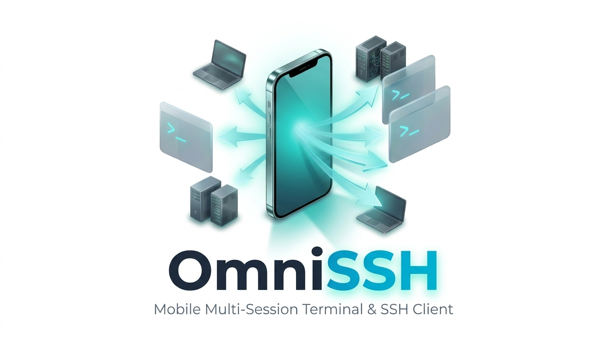
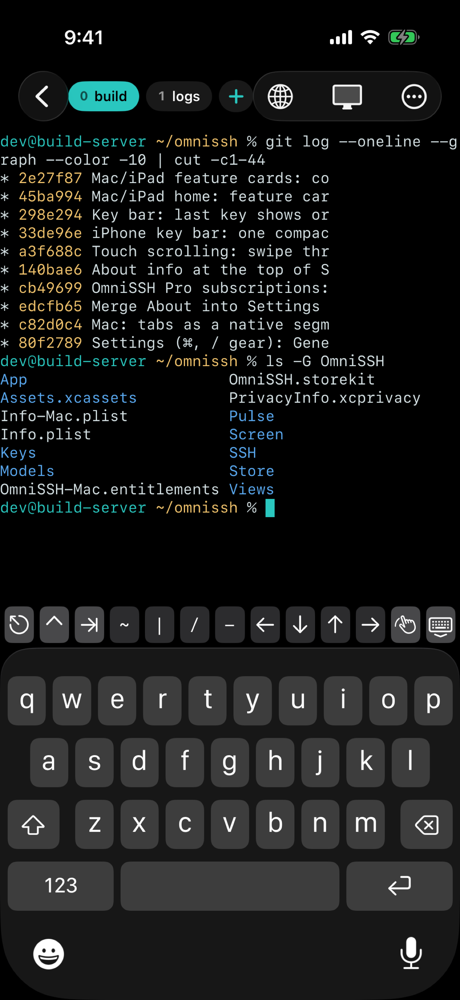
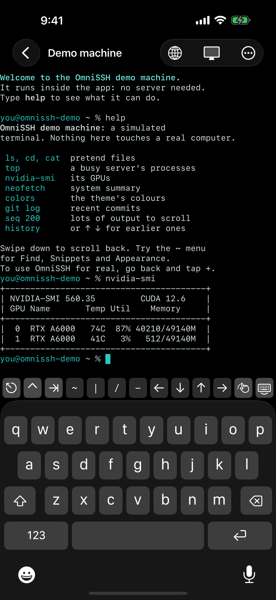
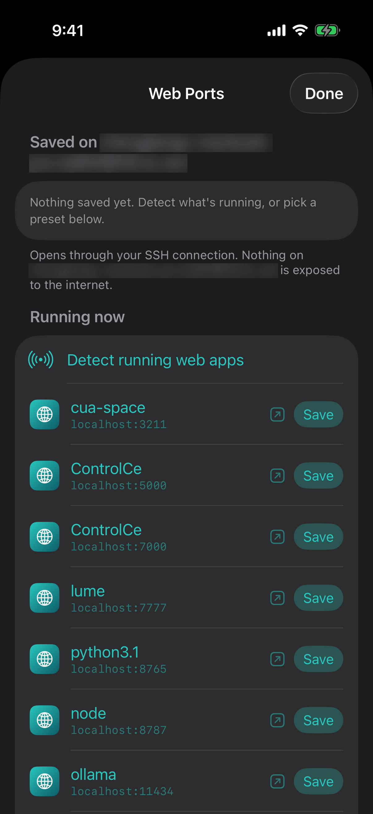
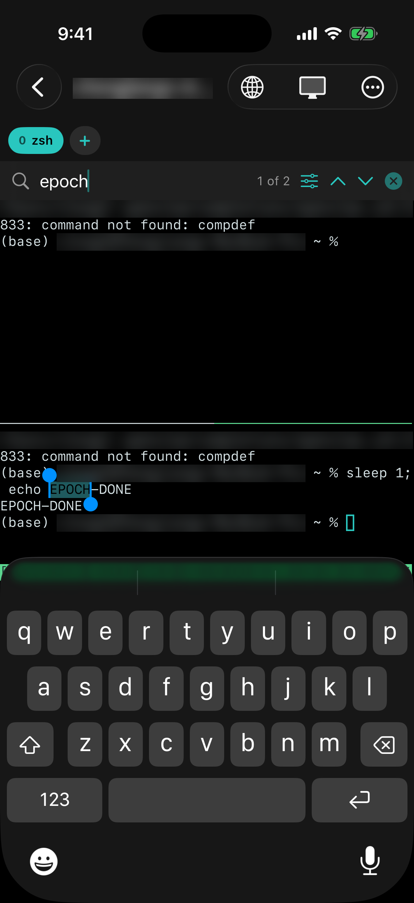

# OmniSSH

**Every machine you own, one tap from your pocket.**

OmniSSH is a multi-session terminal and SSH client for iPhone, iPad and Mac. It lets you control your desktops and servers from anywhere, with keys kept in the Secure Enclave and reachability over Tailscale.

## Screenshots

| Home | Terminal | Demo machine |
|---|---|---|
|  |  |  |

| Live status | Web Ports | Split panes and find |
|---|---|---|
|  |  |  |

More in [docs/screenshots](docs/screenshots). Hostnames, IP addresses and user names in screenshots of real machines are blurred.

## Documentation

- [Research](docs/RESEARCH.md): survey of iOS SSH apps and Swift libraries, and the chosen stack (SwiftUI, Citadel/SwiftNIO SSH, SwiftTerm, Secure Enclave keys, Tailscale).
- [Mac setup](docs/MAC-SETUP.md): set up a Mac as an SSH target (Remote Login, Tailscale, tmux, keys only).
- [App Store listing](docs/APP-STORE-LISTING.md): listing text, review notes and screenshot sizes.
- [Demo server](docs/DEMO-SERVER.md): a locked-down server for App Review, if Apple asks for a real connection.

## Brand assets

- [assets/app-icon.jpg](assets/app-icon.jpg): app icon (1024 × 1024)
- [assets/omnissh-logo.jpg](assets/omnissh-logo.jpg): logo banner

The app's source code is not part of this repository yet.
